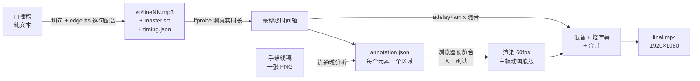

# whiteboard-video-skill

给它一篇口播稿，还你一条带配音和字幕的白板手绘动画成片。

输入是一段纯文本，输出是 1920×1080 / 60fps 的 MP4：逐句配音、手绘线稿逐元素揭示、字幕逐句烧录，音画同步精确到毫秒。

## 效果演示

输入 [15 句口播稿](examples/手绘视频生产线/script.txt)，输出 68 秒成片（约 39 MB）：

**[▶ 查看成片 examples/手绘视频生产线/final.mp4](examples/手绘视频生产线/final.mp4)**

| 产物 | 文件 |
|------|------|
| 口播稿（输入） | `examples/手绘视频生产线/script.txt` |
| 手绘线稿 | `examples/手绘视频生产线/scene-01.hd.png` |
| 标注文件（区域 + 时序） | `examples/手绘视频生产线/scene-01.hd.annotation.json` |
| 配音时间轴 | `examples/手绘视频生产线/timing.json` |
| 字幕 | `examples/手绘视频生产线/master.srt` |
| 成片（输出） | `examples/手绘视频生产线/final.mp4` |

整个仓库克隆下来后，用 examples 里的素材可以直接跑通第 4~7 步复现这条成片。

## 工作原理



核心思路一句话：**字幕不用单独做，画不用单独对齐——逐句量配音的真实时长，每句的起止就是字幕的起止，也是画面对应元素的揭示时刻。** 配音说一句话的瞬间，笔尖提前 70 毫秒落纸，声音到哪，画到哪。

## 环境要求

- Python 3.10+（开发环境为 3.13）
- ffmpeg + ffprobe（系统安装，`brew install ffmpeg` 或 `apt install ffmpeg`）
- macOS / Linux（Windows 理论可行，未验证）

## 安装

```bash
git clone https://github.com/<你的用户名>/whiteboard-video-skill.git
cd whiteboard-video-skill
python3 -m venv .venv
source .venv/bin/activate
pip install -r requirements.txt
```

以下命令均假设你在仓库根目录、venv 已激活。

## 快速开始

假设视频工程目录为 `myproject/`，一共七步。第 1~3 步全自动，第 4 步人工确认，第 5~7 步全自动。

### 第 1 步：口播稿 → 逐句配音 + 时间轴

```bash
python scripts/gen_vo_srt.py \
  --text-file myproject/script.txt \
  --outdir myproject/edit/pipeline
```

- 文本按句号 / 感叹号 / 问号 / 换行切句
- 每句单独调 edge-tts 生成 `vo/line01.mp3` ... `lineNN.mp3`
- 用 ffprobe 测每句**真实**时长（edge-tts 输出时长不固定，估算不可靠）
- 时间轴规则：开头 400ms 静音，句间 20ms，末尾 700ms 画面停留
- 产出 `master.srt`（字幕）和 `timing.json`（时间轴，供后续所有步骤使用）

### 第 2 步：准备手绘线稿

线稿是一张 PNG，怎么来都行——AI 生图、手绘扫描、Figma 导出。要求：

- **元素数量 = 口播稿句数**（一句台词对应一个画面元素）
- 构图为横向流程，元素大致从左到右、从上到下排列，大量留白
- 建议风格：暖米黄纸底 `#F5EBD7` + 深灰线条，红 / 橙 / 蓝少量点缀
- **图内不得有任何文字、字母、数字、水印**（字幕由管线烧录，图里带字会穿帮）
- 尺寸优先 1920×1080（非 16:9 也行，第 3 步会适配）

放到 `myproject/assets/scene-01.png`。

> AI 生图提示词可以参考 `examples/手绘视频生产线/` 里的线稿效果；若生成的图带水印，需要先修掉。

### 第 3 步：自动标注 + 画布适配

```bash
# 连通域分析，把线稿里的元素框出来，对齐到配音时间轴
python scripts/auto_annotate.py \
  --artwork myproject/assets/scene-01.png \
  --timing myproject/edit/pipeline/timing.json \
  --output myproject/assets/scene-01.annotation.json

# 等比缩放居中到标准 1920×1080 画布，标注坐标同步变换
python scripts/make_hd.py \
  --artwork myproject/assets/scene-01.png \
  --annotation myproject/assets/scene-01.annotation.json \
  --output-artwork myproject/assets/scene-01.hd.png \
  --output-annotation myproject/assets/scene-01.hd.annotation.json
```

`auto_annotate.py` 的分析逻辑：取四角平均色为背景，色差 > 55 的像素算线条，5×5 膨胀后做连通域分析，过滤面积 < 300 的噪点，按 y 分带 + 带内按 x 排序，取前 N 个（N = 句数）。

> **注意**：如果线稿元素内部笔画被拆碎、或色差低于阈值，自动标注会错位。这时先渲染一张静态预览图检查（见下），错了就手动改 annotation.json 的 region 坐标——格式见 [docs/annotation-schema.md](docs/annotation-schema.md)。

静态预览检查（可选但推荐）：

```bash
python scripts/render/render_annotation_preview.py \
  myproject/assets/scene-01.hd.png \
  myproject/assets/scene-01.hd.annotation.json \
  myproject/assets/preview.png
```

打开 `preview.png`，确认每个编号框都套住了对应元素。

### 第 4 步：浏览器预览台人工确认

```bash
python scripts/open_preview.py \
  --artwork myproject/assets/scene-01.hd.png \
  --annotation myproject/assets/scene-01.hd.annotation.json
```

自动生成一个内联线稿 + 标注的 HTML 预览台并用浏览器打开：

- 点 ▶ 或拖时间轴，直接看揭示动画效果
- 拖区域四边 / 四角改区域；右侧面板改名称、方向、开始 / 结束毫秒
- 拖模块列表调整揭示顺序
- 点「保存本场景」下载更新后的 `.annotation.json`，移动回原路径覆盖

**这步是质量关卡。** 标注错位是成品翻车的第一大原因（见常见坑），渲染很慢，确认好再往下走。

### 第 5 步：渲染白板动画底版

```bash
python scripts/render/render_stream_whiteboard.py \
  myproject/assets/scene-01.hd.png \
  myproject/assets/scene-01.hd.annotation.json \
  myproject/edit/pipeline/base.mp4 \
  --cap-long-edge 1920
```

**必须加 `--cap-long-edge 1920`**，否则按默认 1080 缩放，输出就不是高清横屏。输出 1920×1080、60fps、无音轨的底版。

### 第 6 步：混音 + 烧字幕 + 合成成片

```bash
python scripts/mix_burn.py \
  --video myproject/edit/pipeline/base.mp4 \
  --vo-dir myproject/edit/pipeline/vo \
  --srt myproject/edit/pipeline/master.srt \
  --timing myproject/edit/pipeline/timing.json \
  --output myproject/edit/pipeline/final.mp4
```

内部做三件事：ffmpeg `adelay+amix` 把逐句配音按 timing.json 的起点混成一条音轨；PIL 逐帧烧录白字黑边字幕（字号随视频高度自适应，1080p 约 48px）；音视频合并，音频不足处补静音。

### 复现 examples 里的成片

```bash
python scripts/render/render_stream_whiteboard.py \
  examples/手绘视频生产线/scene-01.hd.png \
  examples/手绘视频生产线/scene-01.hd.annotation.json \
  /tmp/base.mp4 --cap-long-edge 1920

python scripts/mix_burn.py \
  --video /tmp/base.mp4 \
  --vo-dir examples/手绘视频生产线/vo \
  --srt examples/手绘视频生产线/master.srt \
  --timing examples/手绘视频生产线/timing.json \
  --output /tmp/final.mp4
```

（examples 里没带 `vo/` 目录，需先用第 1 步从 `script.txt` 重新生成。）

## 参数速查

### gen_vo_srt.py

| 参数 | 默认 | 说明 |
|------|------|------|
| `--text` / `--text-file` | - | 口播稿，二选一 |
| `--outdir` | - | 输出目录 |
| `--voice` | `zh-CN-YunxiNeural` | edge-tts 音色（如 `zh-CN-YunyangNeural`） |
| `--rate` / `--pitch` | `+0%` / `+0Hz` | 语速 / 音调 |
| `--initial-silence` | 400 | 开头静音 ms |
| `--gap` | 20 | 句间间隔 ms |
| `--tail` | 700 | 末尾画面停留 ms |

### auto_annotate.py

| 参数 | 默认 | 说明 |
|------|------|------|
| `--artwork` | - | 线稿 PNG |
| `--timing` / `--srt` | - | 时间轴来源，二选一 |
| `--output` | - | 输出 annotation.json |
| `--diff-threshold` | 55 | 非背景像素色差阈值，越大越严 |
| `--hand-lead` | 70 | 笔尖提前量 ms |
| `--padding` | 18 | 掩码内边距 px |
| `--tail` | 700 | 末尾停留 ms |

### make_hd.py

| 参数 | 默认 | 说明 |
|------|------|------|
| `--artwork` / `--annotation` | - | 输入 |
| `--output-artwork` / `--output-annotation` | - | 输出 |
| `--width` / `--height` | 1920 / 1080 | 目标画布 |
| `--bg` | 四角中值自适应 | 填充色，如 `#F5EBD7` |

### mix_burn.py

| 参数 | 默认 | 说明 |
|------|------|------|
| `--video` / `--vo-dir` / `--srt` / `--timing` | - | 输入 |
| `--output` | - | 成片路径 |
| `--font-size` | 按高度自适应 | 字幕字号（1080p ≈ 48） |
| `--margin-v` | 按高度自适应 | 字幕底部边距 |

## 常见坑

| 症状 | 原因 | 解法 |
|------|------|------|
| 渲染出的成品不是 1920×1080 | 没加 `--cap-long-edge 1920` | 渲染时补上该参数 |
| 自动标注区域和元素对不上 | 元素笔画被拆碎成多个连通域 / 色差低于阈值 55 | 渲染静态预览图检查，手动改 annotation.json 坐标；或多元素布局先反推真实坐标再手写 |
| OpenCV 写 MP4 空文件 | macOS 不支持 `mp4v` 编码器 | 脚本已自动回退 `avc1`；仍失败检查 ffmpeg |
| 字幕没烧上或位置怪 | 系统 ffmpeg 缺 `libass` | 本管线用 PIL 逐帧烧录，不走 ffmpeg 字幕滤镜，一般不会遇到 |
| edge-tts 限流 / 超时 | 微软端点速率限制 | 等待重试，或改 `--voice` 再试 |
| 图里带水印 / 杂字 | AI 生图自带角标 | 生成后先检查，修掉再进管线（图内带字会与烧录字幕穿帮） |
| 预览台保存的文件找不到 | 走浏览器下载 | 在系统下载目录，文件名 `<名称>.annotation.json`，移回原路径覆盖 |

## 作为 Agent Skill 使用

本仓库同时是一个 skill 包。放进 WorkBuddy（或兼容 Claude Code 等 agent 的技能目录）后，根目录的 [SKILL.md](SKILL.md) 会让 agent 在用户说「给这段文字做个视频」「口播稿转动画」「做成白板动画」时自动接管整个流程，包括调用生图工具出线稿、在预览关卡等待用户确认。

## 目录结构

```
whiteboard-video-skill/
├── README.md
├── SKILL.md               # Agent 技能清单（触发词 + 工作流）
├── LICENSE                # MIT
├── requirements.txt
├── scripts/               # 编排层（本项目的核心）
│   ├── gen_vo_srt.py      #   1. 配音 + SRT + timing.json
│   ├── auto_annotate.py   #   2. 线稿连通域自动标注
│   ├── make_hd.py         #   3. 1920×1080 画布适配
│   ├── open_preview.py    #   4. 浏览器预览台
│   ├── mix_burn.py        #   5. 混音 + 烧字幕 + 合成
│   ├── burn_subtitles.py  #   （mix_burn 的逐帧烧录模块）
│   └── render/            # 渲染引擎（来自 srt-whiteboard-animation，MIT）
│       ├── render_stream_whiteboard.py
│       ├── stream_render.py
│       ├── render_annotation_preview.py
│       ├── parse_srt.py
│       ├── merge_scenes.py
│       └── LICENSE.srt-whiteboard-animation
├── docs/
│   ├── workflow.md        # 各步骤设计细节与时序公式
│   └── annotation-schema.md
└── examples/手绘视频生产线/  # 完整示例工程
```

## 致谢与许可证

- 本仓库编排层以 [MIT](LICENSE) 开源
- `scripts/render/` 渲染引擎来自 [srt-whiteboard-animation](scripts/render/LICENSE.srt-whiteboard-animation)（MIT，© 江哥是老登啊），分区遮罩 + 流式笔迹的核心绘制能力由它提供
- 配音使用微软 [edge-tts](https://github.com/rany2/edge-tts)
